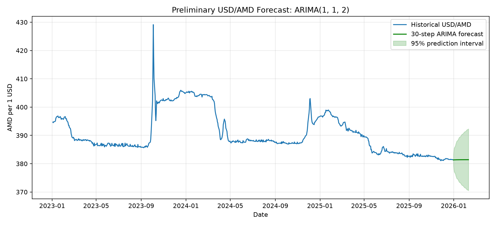

# USD/AMD փոխարժեքի վերլուծություն և կանխատեսում

## Նպատակ
Այս կուրսային աշխատանքի նպատակն է ուսումնասիրել ԱՄՆ դոլարի և հայկական դրամի փոխարժեքի ժամանակային շարքը և փորձել կանխատեսում կատարել ARIMA մոդելով։

## Աշխատանքի փուլերը
- Տվյալների ուսումնասիրություն և մաքրում
- Փոխարժեքի գրաֆիկի կառուցում
- Ժամանակային շարքի վերլուծություն
- ARIMA մոդելի ընտրություն և կառուցում
- Կանխատեսման ճշտության գնահատում
- Արդյունքների ներկայացում

## Օգտագործվող գործիքներ
- Python
- pandas
- matplotlib
- statsmodels

## Աղբյուրներ
- [Forecasting: Principles and Practice — Getting started](https://otexts.com/fpp3/intro.html)

## Տվյալների արտասովոր շարժը

2023 թ. հոկտեմբերի 2–10-ին USD/AMD փոխարժեքը կտրուկ բարձրացել և ապա նվազել է։ Այս արժեքները համընկնում են Հայաստանի Կենտրոնական բանկի պաշտոնական արխիվի հետ, ուստի դիտարկումները պահպանվել են և չեն հեռացվել որպես սխալ տվյալներ։

Համաշխարհային բանկի 2023 թ. հոկտեմբերի տեղեկագրում նշվում է, որ դրամը ժամանակավորապես արժեզրկվել էր․ հոկտեմբերի 4-ին փոխարժեքը մոտ 11%-ով բարձրացել էր, իսկ հետո սկսել էր նվազել։

Աղբյուրներ՝
- [ԿԲ փոխարժեքների արխիվ](https://old.cba.am/EN/SitePages/ExchangeArchive.aspx?DateTo=2025-10-01&ISOCodes=USD)
- [Համաշխարհային բանկի 2023 թ. հոկտեմբերի տեղեկագիր](https://thedocs.worldbank.org/en/doc/a1eefb804807dc836cdd039c1524420a-0080012023/original/ARM-MEU-OCT-2023.pdf)

## Մոդելի արդյունքները

Տվյալները բաժանվել են ժամանակագրական կարգով․ 605 դիտարկում՝ ուսուցման, 152 դիտարկում՝ ստուգման համար։ ADF թեստի արդյունքը ցույց է տվել, որ սկզբնական շարքը ստացիոնար չէ (p-value = 0.3283), իսկ առաջին տարբերությունը ստացիոնար է (p-value ≈ 0.0)։ Այդ պատճառով մոդելում օգտագործվել է d = 1։

Մի քանի ARIMA կարգերի համեմատությունից հետո validation տվյալներով ընտրվել է ARIMA(1, 1, 2) մոդելը։

Ստուգման տվյալների վրա ARIMA(1, 1, 2)-ի MAE-ն 1.145 է, իսկ RMSE-ն՝ 1.388։ Պարզ կանխատեսման համապատասխան արժեքներն են 1.195 և 1.44։ Այս տվյալներով ARIMA մոդելը փոքր-ինչ ավելի լավ արդյունք է տվել։

Հաջորդ 30 աշխատանքային օրվա կանխատեսումը սկսվում է 2025-12-31-ից։ Առաջին կանխատեսումը 381.33 AMD է՝ 95% կանխատեսման միջակայքով՝ 379.30–383.36 AMD։

Ljung-Box թեստի p-value-ն շատ փոքր է (տպված՝ 0.0), ինչը ցույց է տալիս, որ մնացորդներում դեռ առկա է ավտոկոռելյացիա։ Հետևաբար մոդելի արդյունքները պետք է դիտարկել որպես նախնական, և մոդելը դեռ բարելավման կարիք ունի։

## Ապագա կանխատեսման գրաֆիկ



### ARIMA(1, 1, 2)-ի իմաստը

ARIMA կարգը գրվում է (p, d, q) տեսքով․

- **p = 1**․ մոդելն օգտագործում է մեկ նախորդ արժեքի ազդեցությունը։
- **d = 1**․ շարքի առաջին տարբերությունն է վերցվում՝ ստացիոնարության հասնելու համար։
- **q = 2**․ մոդելն օգտագործում է նախորդ երկու կանխատեսման սխալների ազդեցությունը։

Այս կարգն ընտրվել է՝ տարբեր ARIMA մոդելների validation արդյունքները համեմատելուց հետո։
## Եզրակացություն

Վերլուծության արդյունքում սկզբնական USD/AMD շարքը ստացիոնար չի եղել, իսկ առաջին տարբերությունից հետո դարձել է ստացիոնար։ Validation արդյունքներով ընտրվել է ARIMA(1, 1, 2) մոդելը։

Ստուգման տվյալների վրա մոդելի MAE-ն 1.145 է, իսկ RMSE-ն՝ 1.388։ Պարզ կանխատեսման արժեքներն են՝ համապատասխանաբար 1.195 և 1.44։ Այս տվյալների վրա ARIMA մոդելը փոքր-ինչ ավելի ճշգրիտ է եղել։

Միևնույն ժամանակ, Ljung-Box թեստը ցույց է տվել, որ մնացորդներում դեռ ավտոկոռելյացիա կա։ Ուստի կանխատեսումը պետք է դիտարկել որպես մոտավոր գնահատական, ոչ թե երաշխավորված փոխարժեք։
## Ինչպես գործարկել նախագիծը

Excel տվյալները գտնվում են `data/usd_amd_data.xlsx` ֆայլում։

Նախագիծը գործարկելու համար՝

```powershell
python -m venv .venv
.\.venv\Scripts\python.exe -m pip install -r requirements.txt
.\.venv\Scripts\python.exe data_check.py