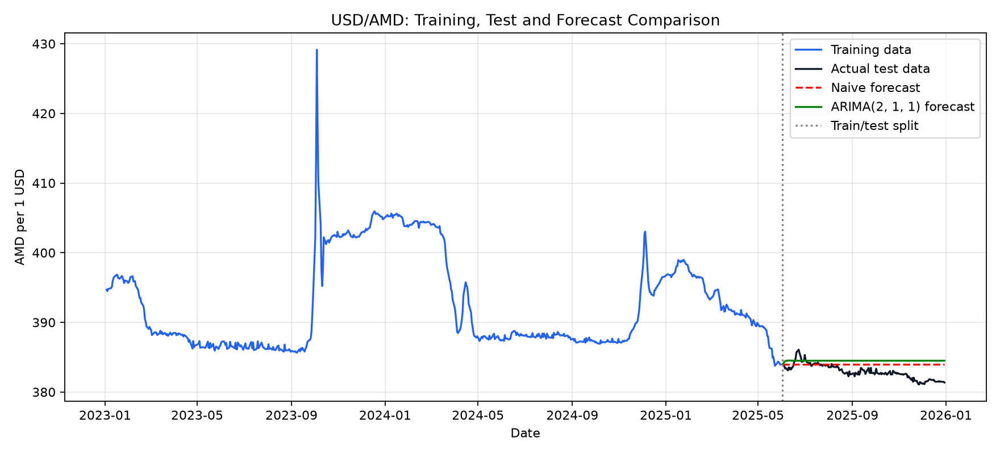
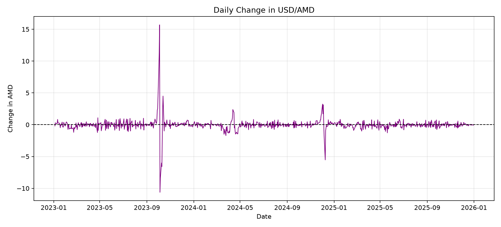
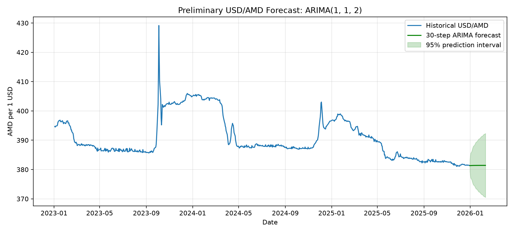

# Ժամանակային շարքերի վերլուծություն և կանխատեսում ARIMA մոդելի միջոցով

## Ներածություն
Ժամանակային շարքերի ուսումնասիրությունը հնարավորություն է տալիս վերլուծել տվյալների փոփոխությունը ժամանակի ընթացքում և կազմել կանխատեսումներ։ Արտարժույթի փոխարժեքը կարող է փոփոխվել տնտեսական և այլ իրադարձությունների ազդեցությամբ, ուստի դրա պատմական շարժի ուսումնասիրությունը կարևոր է։

Այս աշխատանքի նպատակն է վերլուծել ԱՄՆ դոլարի և հայկական դրամի՝ USD/AMD փոխարժեքի ժամանակային շարքը և ARIMA մոդելի միջոցով կազմել կանխատեսում։

**Ուսումնասիրության օբյեկտը** USD/AMD փոխարժեքի օրական տվյալներն են՝ 2023 թվականի հունվարի 3-ից մինչև 2025 թվականի դեկտեմբերի 30-ը։ **Ուսումնասիրության առարկան** այդ շարքի ժամանակային փոփոխություններն ու ARIMA մոդելի կիրառումն են կանխատեսման համար։

Աշխատանքի նպատակին հասնելու համար կատարվել են հետևյալ քայլերը․

- ուսումնասիրվել և գրաֆիկորեն ներկայացվել են փոխարժեքի տվյալները,
- ստուգվել է ժամանակային շարքի ստացիոնարությունը,
- համեմատվել են ARIMA-ի մի քանի կարգեր,
- մոդելները գնահատվել են MAE և RMSE չափանիշներով,
- ստուգվել են մոդելի մնացորդները,
- կազմվել է ապագա ժամանակային քայլերի կանխատեսում՝ 95% կանխատեսման միջակայքով։

Վերլուծությունն իրականացվել է Python-ի միջոցով՝ օգտագործելով pandas, matplotlib և statsmodels գրադարանները։
## Գլուխ 1․ Ժամանակային շարքերի տեսական հիմքերը
### 1.1 Ժամանակային շարքի հասկացությունը

Ժամանակային շարքը տվյալների դիտարկումների հաջորդականություն է, որտեղ յուրաքանչյուր արժեք կապված է որոշակի ժամանակի հետ։ Օրինակ՝ USD/AMD փոխարժեքի շարքում յուրաքանչյուր արժեք ցույց է տալիս փոխարժեքը տվյալ օրվա համար։ Այս տվյալներում դիտարկումների հերթականությունը կարևոր է, քանի որ նախորդ արժեքները կարող են կապ ունենալ հաջորդ արժեքների հետ։

Ժամանակային շարքում սովորաբար տարբերակում են մի քանի բաղադրիչ՝

- **միտում**՝ երկարաժամկետ աճ կամ նվազում,
- **սեզոնայնություն**՝ որոշակի ժամանակահատվածներում կրկնվող օրինաչափություն,
- **ցիկլային փոփոխություններ**՝ ավելի երկարատև տատանումներ, որոնք պարտադիր չէ՝ կրկնվեն նույն պարբերականությամբ,
- **պատահական բաղադրիչ**՝ չբացատրված կարճաժամկետ տատանումներ։

Արտարժույթի փոխարժեքի շարքում կարող են լինել ինչպես երկարաժամկետ շարժեր, այնպես էլ առանձին իրադարձություններով պայմանավորված կտրուկ փոփոխություններ։

### 1.2 Ստացիոնարություն

Ստացիոնար ժամանակային շարքի հիմնական վիճակագրական հատկությունները ժամանակի ընթացքում էականորեն չեն փոխվում։ Մասնավորապես, միջինը և տատանումների չափը մոտավորապես կայուն են։

Ստացիոնարությունը ստուգելու համար կիրառվում է ընդլայնված Դիքեյ-Ֆուլլերի՝ ADF թեստը։ Թեստի փոքր p-value-ն հիմք է տալիս մերժելու այն վարկածը, որ շարքն ունի միավոր արմատ և ստացիոնար չէ։

Եթե շարքը ստացիոնար չէ, այն կարող է վերափոխվել տարբերակման միջոցով։ Առաջին տարբերությունը հաշվվում է հարևան դիտարկումների տարբերությամբ՝ ընթացիկ արժեքից հանելով նախորդ արժեքը։ Այս աշխատանքի տվյալների վրա առաջին տարբերության կիրառումը շարքը դարձրել է ստացիոնար։

### 1.3 ARIMA մոդելը

ARIMA մոդելի անվանումը կազմված է երեք մասից՝ Autoregressive Integrated Moving Average։ Այն գրվում է ARIMA(p, d, q) տեսքով։

- **p**-ը ցույց է տալիս, թե քանի նախորդ դիտարկման կապն է օգտագործվում մոդելում։
- **d**-ը ցույց է տալիս, թե քանի անգամ է շարքը տարբերակվում՝ ստացիոնարության հասնելու համար։
- **q**-ը ցույց է տալիս, թե քանի նախորդ կանխատեսման սխալ է օգտագործվում մոդելում։

Այս աշխատանքի համար համեմատվել են ARIMA-ի մի քանի կարգեր։ Ընտրությունը կատարվել է validation տվյալների վրա՝ ըստ կանխատեսման սխալների։

### 1.4 Կանխատեսման ճշտության չափանիշները

Մոդելները համեմատելու համար օգտագործվել են MAE և RMSE չափանիշները։

- **MAE**-ն կանխատեսված և իրական արժեքների բացարձակ տարբերությունների միջինն է։
- **RMSE**-ն սխալների քառակուսիների միջինի քառակուսի արմատն է։ Այն ավելի մեծ չափով է հաշվի առնում խոշոր սխալները։

Երկու չափանիշների դեպքում էլ ավելի փոքր արժեքը նշանակում է ավելի ճշգրիտ կանխատեսում։ Դրանք համեմատվել են նույն ստուգման ժամանակահատվածի համար։
## Գլուխ 2․ Տվյալների նկարագրություն և վերլուծություն

### 2.1 Տվյալների նկարագրությունը

Ուսումնասիրության համար օգտագործվել են ԱՄՆ դոլարի և հայկական դրամի USD/AMD փոխարժեքի օրական տվյալները։ Տվյալների շարքն ընդգրկում է 2023 թվականի հունվարի 3-ից մինչև 2025 թվականի դեկտեմբերի 30-ը՝ ընդհանուր 757 դիտարկում։

Վերլուծության հիմնական փոփոխականներն են ամսաթիվը և փոխարժեքը։ Դրանց հիման վրա ուսումնասիրվել են փոխարժեքի շարժը և օրական փոփոխությունները։

### 2.2 Տվյալների նախապատրաստումը

Տվյալները բեռնվել են Excel ֆայլից։ Ամսաթվի սյունակը փոխակերպվել է ամսաթվի ձևաչափի, բացակայող ամսաթվով կամ փոխարժեքով տողերը հեռացվել են, իսկ դիտարկումները դասավորվել են ժամանակագրական հերթականությամբ։

Տվյալները պատահականորեն չեն խառնվել։ Առաջին 605 դիտարկումն օգտագործվել է ուսուցման համար, իսկ վերջին 152 դիտարկումը՝ վերջնական ստուգման համար։ Ստուգման ժամանակահատվածը սկսվում է 2025 թվականի հունիսի 2-ից։ Այս բաժանումը պահպանում է ժամանակային հերթականությունը։

### 2.3 Փոխարժեքի գրաֆիկական ուսումնասիրումը

Պատմական փոխարժեքի գրաֆիկը ցույց է տալիս, որ շարքը ժամանակի ընթացքում փոփոխվել է և ունեցել է նաև կտրուկ տատանումներ։ Օրինակ՝ 2023 թվականի հոկտեմբերի սկզբին դիտվել են տվյալների շարքի ամենամեծ օրական փոփոխություններից մի քանիսը։

Գրաֆիկական ուսումնասիրությունն օգնում է տեսնել ընդհանուր շարժը և առանձնահատուկ տատանումները, սակայն ինքնին բավարար չէ շարքի ստացիոնարությունը որոշելու համար։ Դրա համար կիրառվել է ADF թեստը։

## Գլուխ 3․ ARIMA մոդելի կառուցում և կանխատեսում

### 3.1 Ստացիոնարության ստուգում

Սկզբնական շարքի ADF թեստի p-value-ն 0.3283 է։ Քանի որ այն մեծ է 0.05-ից, սկզբնական շարքը ստացիոնար չի համարվել։ Առաջին տարբերության p-value-ն ծրագրի արդյունքով մոտավորապես 0.0 է, այսինքն՝ փոքր է 0.05-ից։ Հետևաբար մոդելում կիրառվել է մեկ տարբերակում՝ d = 1։

### 3.2 ARIMA կարգի ընտրություն

Համեմատվել են ARIMA-ի մի քանի կարգեր՝ validation տվյալների վրա։ Ամենափոքր validation MAE-ն ունեցել է ARIMA(1, 1, 2) մոդելը՝ MAE = 3.316 և RMSE = 4.026։ Այդ պատճառով այն ընտրվել է վերջնական գնահատման համար։

### 3.3 Մոդելի գնահատում

Վերջնական ստուգման տվյալների վրա ARIMA(1, 1, 2) մոդելի MAE-ն 1.145 է, իսկ RMSE-ն՝ 1.388։ Պարզ կանխատեսման MAE-ն 1.195 է, RMSE-ն՝ 1.44։ Այս համեմատությամբ ARIMA մոդելի սխալները մի փոքր ավելի փոքր են եղել։

Ljung-Box թեստի p-value-ն կլորացված տպվել է որպես 0.0։ Սա ցույց է տալիս, որ մնացորդներում դեռ ավտոկոռելյացիա կա։ Հետևաբար մոդելը չի նկարագրում շարքի բոլոր օրինաչափությունները։

### 3.4 Ապագա արժեքների կանխատեսում

Կազմվել է հաջորդ 30 կանխատեսման քայլերի գնահատական՝ 95% կանխատեսման միջակայքով։ Առաջին կանխատեսումը 2025 թվականի դեկտեմբերի 31-ի համար է՝ 381.33 AMD։ Դրա 95% կանխատեսման միջակայքը 379.30–383.36 AMD է։

Կանխատեսման հետագա քայլերի համար միջակայքը լայնանում է, ինչը ցույց է տալիս, որ ավելի հեռու ժամանակահատվածների գնահատականների անորոշությունն ավելի մեծ է։

## Եզրակացություն

Աշխատանքի ընթացքում ուսումնասիրվել է USD/AMD փոխարժեքի 757 դիտարկումից կազմված ժամանակային շարքը։ ADF թեստի արդյունքներով սկզբնական շարքը ստացիոնար չի եղել, իսկ առաջին տարբերությունից հետո դարձել է ստացիոնար։ Տարբեր ARIMA կարգերի համեմատությունից հետո ընտրվել է ARIMA(1, 1, 2) մոդելը։

Ստուգման տվյալների վրա մոդելի MAE-ն կազմել է 1.145, իսկ RMSE-ն՝ 1.388։ Սրանք փոքր-ինչ ավելի ցածր են եղել պարզ կանխատեսման MAE = 1.195 և RMSE = 1.44 արժեքներից։ Այսպիսով, ուսումնասիրված ժամանակահատվածում ARIMA մոդելը փոքր առավելություն է ունեցել պարզ ելակետային կանխատեսման նկատմամբ։

Միևնույն ժամանակ, Ljung-Box թեստը ցույց է տվել, որ մնացորդներում պահպանվում է ավտոկոռելյացիա։ Հետևաբար մոդելը չի նկարագրում շարքի բոլոր օրինաչափությունները, իսկ ապագա կանխատեսումները պետք է դիտարկել որպես մոտավոր գնահատականներ։ Հետագա աշխատանքում կարելի է փորձարկել այլ մոդելներ և ներառել փոխարժեքի վրա ազդող լրացուցիչ տնտեսական գործոններ։

## Օգտագործված աղբյուրներ

1. Hyndman, R. J., Athanasopoulos, G. *Forecasting: Principles and Practice*, 3rd edition. [Առցանց գիրք](https://otexts.com/fpp3/)
2. Hamilton, J. D. *Time Series Analysis*. Princeton University Press, 1994. [Հրատարակչի էջ](https://press.princeton.edu/books/hardcover/9780691042893/time-series-analysis)
3. Հայաստանի Կենտրոնական բանկ։ [Փոխարժեքների արխիվ](https://www.cba.am/en/exchange-rates-archive/)